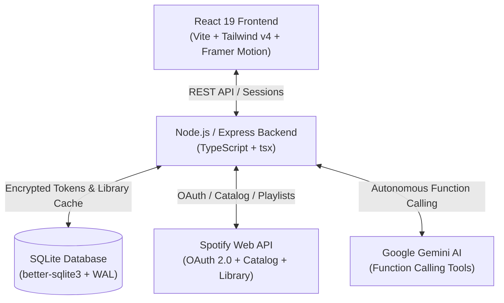

<div align="center">

# 🎵 Spotify Companion AI

**Your Autonomous, AI-Powered Music Curator & Playlist Architect**

[](https://www.typescriptlang.org/)
[](https://react.dev/)
[](https://nodejs.org/)
[](https://vitejs.dev/)
[](https://tailwindcss.com/)
[](https://developer.spotify.com/)
[](https://ai.google.dev/)
[](https://opensource.org/licenses/MIT)

<p align="center">
  Spotify Companion AI analyzes your authentic listening personality from your library history, decodes your multidimensional Music DNA, discovers hidden gems, and designs deliberate, expertly paced playlists exported directly to your Spotify account.
</p>

[Key Features](#-key-features) •
[Architecture](#-architecture--tech-stack) •
[Quickstart](#-quickstart-guide) •
[PWA Installation](#-progressive-web-app-pwa) •
[Cloud Deployment](#-production-deployment) •
[API Reference](#-api-endpoints)

---

</div>

## 🌟 Key Features

### 🔐 Spotify OAuth 2.0 Security
- **Confidential Authorization Code Flow**: Implements strict CSRF state verification and PKCE standards.
- **Encrypted Local Sessions**: Stores session tokens and encrypted refresh tokens in high-performance SQLite storage.
- **Automatic Token Management**: Proactive background token refresh prior to expiration and graceful revocation upon disconnect.

### ⚡ Smart Library Synchronization & SQLite Cache
- **Deep Library Fetching**: Seamlessly syncs your Top Tracks across three distinct time horizons (Short-term / 4 weeks, Medium-term / 6 months, Long-term / all time), Top Artists (140+), Saved Tracks (200+), and recent listening history.
- **Sub-Millisecond Query Speeds**: Uses **SQLite with Write-Ahead Logging (WAL)** mode for persistent, offline-first local caching, preventing Spotify API rate-limit bottlenecks.

### 🧬 Multidimensional Music DNA Engine
- **Independent Taste Archetyping**: Calculates your musical personality (e.g., *The Melodic Enthusiast*, *The Sonic Explorer*, *The Nostalgic Purist*) without relying on deprecated Spotify audio-features endpoints.
- **Deep Metrics**:
  - **Mainstream vs. Underground Index**: Analyzes popularity distributions across your entire catalog.
  - **Artist Loyalty Score**: Quantifies your catalog breadth vs. repeat-listening concentration.
  - **Acoustic & Energy Profiles**: Infers mood and vibe dynamics based on genre signatures and track metadata.

### 🤖 Autonomous Conversational Curator (Google Gemini)
- **Direct Library Tool Calling**: Powered by `gemini-3.8-flash` with autonomous function execution.
- **Intelligent Assistant Tools**: The AI can query your listening history, search Spotify's global catalog, explore your Music DNA profile, and construct custom track sequences on the fly.
- **Context-Aware Recommendations**: Recommends songs based on mood, tempo, activity, genre blend, or obscure thematic prompts.

### 🎧 1-Click Playlist Architect
- **Smart Pacing & Flow**: Curates tracks with intentional progression (intro build-up, peak energy, mellow cooldown).
- **Direct Spotify Export**: Generates real playlists in your active Spotify account with customizable titles and descriptions.
- **Instant Playback Links**: Provides direct Spotify deep links to launch your new playlist immediately in the Spotify desktop or mobile app.

### 🔄 Adaptive Feedback & Context Memory
- **Real-Time Reactions**: Granular Like & Dislike actions on every recommendation.
- **System Memory Training**: Positive and negative feedback dynamically trains Gemini's system context, refining future suggestions to match your evolving tastes.

### 🎨 Modern Dark-Mode Interface
- **Fluid & Responsive**: Built with React 19, TypeScript, and Tailwind CSS v4.
- **Interactive UI Components**: Features dynamic ambient Aura gradients, interactive Spotlight cards, Circular 3D galleries, text blur-in reveals, and count-up animations.

---

## 🏗️ Architecture & Tech Stack



| Layer | Technologies |
|---|---|
| **Frontend** | React 19, TypeScript, Vite, Tailwind CSS v4, Lucide React, Framer Motion, Axios, React Router 7 |
| **Backend** | Node.js, Express, TypeScript, tsx, express-session, connect-sqlite3, Helmet, CORS, node-fetch |
| **Database** | SQLite (via `better-sqlite3` with WAL mode) |
| **AI Intelligence** | Google Generative AI SDK (`@google/generative-ai`), `gemini-3.8-flash` with Function Calling |
| **External APIs** | Spotify Web API (Authorization Code Flow, Library, Browse, Playlists) |
| **Deployment** | Docker, Render (`render.yaml`), Railway |

---

## 🚀 Quickstart Guide

### 1. Prerequisites
- **Node.js** (v18.0.0 or higher)
- **npm** (v9.0.0 or higher)
- A **Spotify Account** (Free or Premium)
- A **Google Gemini API Key** (from [Google AI Studio](https://aistudio.google.com/))

---

### 2. Configure Spotify Developer Application

1. Go to the [Spotify Developer Dashboard](https://developer.spotify.com/dashboard) and log in.
2. Click **Create App**:
   - **App Name**: `Spotify Companion AI`
   - **App Description**: `Personalized AI Music Curator`
   - **Redirect URI**: `http://127.0.0.1:3000/auth/spotify/callback`
   - **APIs Used**: Select **Web API**.
3. Save the app and note your **Client ID** and **Client Secret** from the app settings.

---

### 3. Clone & Configure Environment

```bash
# Clone the repository
git clone https://github.com/abhiraj-arya2006/Spotify-Companion.git
cd Spotify-Companion
```

Create a `.env` file in the `backend/` directory:

```bash
cp backend/.env.example backend/.env
```

Fill in your credentials in `backend/.env`:

```ini
# Spotify Developer Credentials
SPOTIFY_CLIENT_ID=your_spotify_client_id_here
SPOTIFY_CLIENT_SECRET=your_spotify_client_secret_here
SPOTIFY_REDIRECT_URI=http://127.0.0.1:3000/auth/spotify/callback

# Google Gemini API
GEMINI_API_KEY=your_gemini_api_key_here

# Application Configuration
SESSION_SECRET=create_a_random_32_character_secret_key_here
PORT=3000
NODE_ENV=development
```

---

### 4. Install Dependencies & Run

From the root directory:

```bash
# Install all root, backend, and frontend dependencies
npm run install:all

# Option A: Start in development mode (with live watch)
npm run dev

# Option B: Build and run production server
npm run build
npm start
```

Open your browser and navigate to:
👉 **[http://127.0.0.1:3000](http://127.0.0.1:3000)**

Log in with your Spotify account, click **Sync Library**, and explore your Music DNA and AI Curator!

---

## 📱 Progressive Web App (PWA)

Spotify Companion AI is built as a fully responsive Progressive Web App that works seamlessly across all devices and screen sizes:

- **Desktop (Chrome / Edge / Brave)**: Click the **Install** icon in the browser address bar or select *Install Spotify Companion AI* from the browser menu.
- **iOS (Safari)**: Tap the **Share** button at the bottom of the screen → select **Add to Home Screen**.
- **Android (Chrome)**: Tap the three-dot menu → tap **Install App** or **Add to Home Screen**.

---

## ☁️ Production Deployment

### Option A: Render.com (Recommended)
This repository includes a pre-configured `render.yaml` for automatic deployment:

1. Push your repository to your GitHub account.
2. In the [Render Dashboard](https://dashboard.render.com/), click **New** → **Blueprint**.
3. Connect your repository — Render will automatically detect the configuration.
4. Set the following environment variables in the Render settings:
   - `SPOTIFY_CLIENT_ID`
   - `SPOTIFY_CLIENT_SECRET`
   - `SPOTIFY_REDIRECT_URI`: `https://your-service-name.onrender.com/auth/spotify/callback`
   - `GEMINI_API_KEY`
   - `SESSION_SECRET`
5. Update your **Spotify Developer Dashboard**: add your production callback URL (`https://your-service-name.onrender.com/auth/spotify/callback`) under *Redirect URIs*.

---

### Option B: Docker Container

A multi-stage `Dockerfile` is provided in the root directory:

```bash
# 1. Build the Docker image
docker build -t spotify-companion .

# 2. Run the container
docker run -d \
  -p 3000:3000 \
  --env-file backend/.env \
  --name spotify-companion-app \
  spotify-companion
```

---

## 📡 API Endpoints

### Authentication & User
| Method | Endpoint | Description |
|---|---|---|
| `GET` | `/auth/spotify` | Initiates Spotify OAuth 2.0 flow with CSRF state |
| `GET` | `/auth/spotify/callback` | Handles OAuth callback, exchanges code for tokens |
| `GET` | `/auth/me` | Returns current user profile and connection status |
| `POST` | `/auth/logout` | Clears user session and revokes cached credentials |

### Library & Music DNA
| Method | Endpoint | Description |
|---|---|---|
| `POST` | `/api/sync` | Fetches and syncs top tracks, artists, and saved tracks |
| `GET` | `/api/sync/status` | Returns timestamp and count of cached library data |
| `GET` | `/api/dna` | Returns computed Music DNA, taste archetype, and metrics |
| `GET` | `/api/library/overview` | Retrieves library summary for dashboard visualization |

### AI Curator & Playlists
| Method | Endpoint | Description |
|---|---|---|
| `POST` | `/api/chat` | Sends message to Gemini AI curator with library tool access |
| `POST` | `/api/feedback` | Records user Like/Dislike reaction to train AI recommendations |
| `POST` | `/api/playlist/create` | Creates a new Spotify playlist and adds tracks directly |
| `POST` | `/api/playlist/resolve` | Resolves track queries against Spotify's global catalog |

---

## 📂 Project Structure

```text
Spotify-Companion/
├── backend/
│   ├── src/
│   │   ├── config/          # Environment configuration & constants
│   │   ├── db/              # SQLite schema, migrations & database instance
│   │   ├── middleware/      # Auth validation, error handling & security
│   │   ├── routes/          # Express route handlers (auth, sync, chat, playlist)
│   │   ├── services/
│   │   │   ├── ai/          # Gemini AI service & autonomous tool definitions
│   │   │   ├── music-dna.service.ts  # DNA & taste archetype computation
│   │   │   ├── spotify.service.ts    # Spotify Web API client & token manager
│   │   │   └── sync.service.ts       # Library synchronization logic
│   │   └── server.ts        # Express application entrypoint
│   ├── package.json
│   └── tsconfig.json
│
├── frontend/
│   ├── public/              # Web app manifest, service worker & icons
│   ├── src/
│   │   ├── api/             # API client functions & Axios setup
│   │   ├── components/      # UI components (Header, Sidebar, Aura, Cards)
│   │   ├── pages/           # Application views (Overview, Music DNA, Chat, Playlists)
│   │   ├── types/           # TypeScript interfaces & definitions
│   │   ├── App.tsx          # Router and application layout
│   │   └── main.tsx         # React entrypoint
│   ├── package.json
│   └── vite.config.ts
│
├── Dockerfile               # Multi-stage production container build
├── render.yaml              # Render.com deployment blueprint
├── package.json             # Root orchestration scripts
└── README.md                # Project documentation
```

---

## 🔒 Security & Privacy

- **No Credential Exposure**: Client credentials and API keys remain strictly server-side.
- **Encrypted Local Storage**: Sensitive tokens stored in SQLite are protected with session-level isolation.
- **Minimal Scopes**: Requests only the minimum required Spotify permissions (`user-read-private`, `user-read-email`, `user-top-read`, `user-library-read`, `playlist-modify-public`, `playlist-modify-private`).
- **Your Data Remains Yours**: Library and Music DNA data are stored locally in your SQLite instance and never shared with third parties.

---

## 📄 License

This project is open-source and available under the [MIT License](LICENSE).
